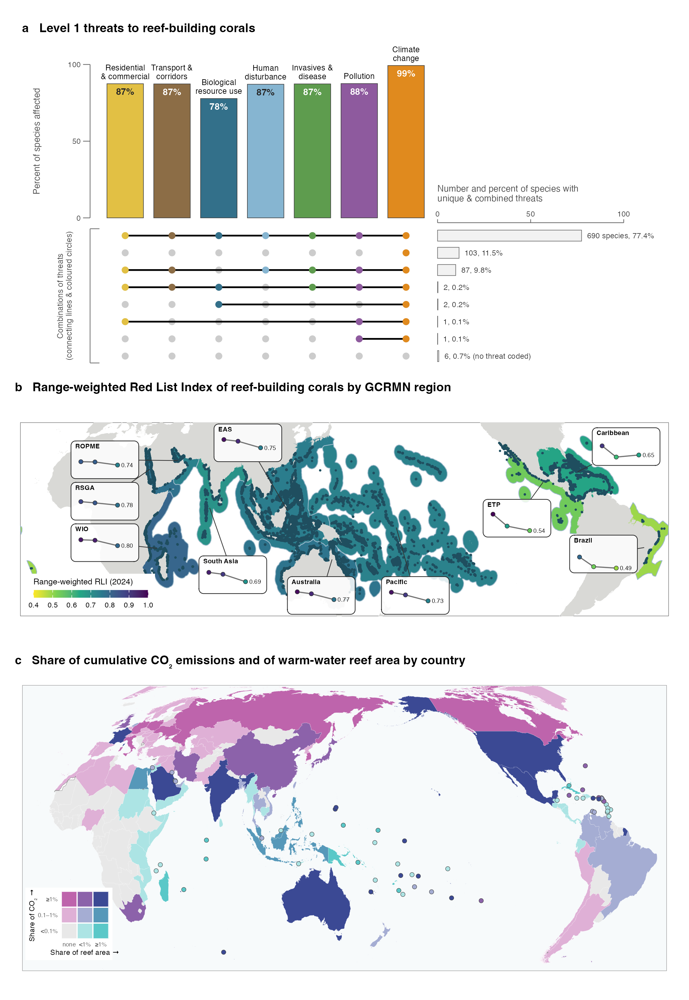

# coralRLI: threats, Red List Index and CO₂ responsibility for reef-building corals

[](https://doi.org/10.5281/zenodo.24566966)

This repository holds the minimal data and code needed to reproduce the
three-panel figure on reef-building corals in:

Yan HF and Dulvy NK. (2026) Accelerating extinction risk of reef-building corals.

This is a commentary on this recent paper which we encourage you to read: Obura DO, Polidoro B, Cabada-Blanco F, Linardich C, Carpenter N, Gutierrez L, Kemppinen K, Pettersson E, Strongin K, Aeby G, Alliji K, Alvarado JJ, Alvarez-Filip L, Casado De Amezua P, Banaszak A, Bayley DTI, Bluemel JK, Cortés J, Couce E, Cowburn B, Crabbe MJC, Croquer A, Dellisanti W, Devantier L, Edwards A, Feingold J, Gegner HM, Goergen E, Goffredo S, Hoeksema BW, Huang D, Johnson J, Kennedy E, Kersting DK, Kim SW, Kitahara MV, Kružić P, Lewis CJ, Licuanan WY, Luzon KS, Miller MW, Montgomery AD, Murray J, Ng CSL, Nunes F, Nuñez-Lendo CI, Pearce-Kelly P, Porter SN, Quimbayo JP, Range P, Richards Z, Rivera-Sosa A, Roche R, Rodríguez-Martínez RE, De La Rosa G, Rosell K, Samimi-Namin K, Santodomingo N, Shlesinger T, Sweet M, Turak E, Van Hooidonk R, Vermeij M, Villamizar E, Waheed Z and Wilson B. (2026) Nearly half of reef-building corals face elevated relative risk of extinction. *Nature*. https://doi.org/10.1038/s41586-026-11263-3



The figure shows (a) the threats coded for the world's 892 reef-building
corals, (b) how their extinction risk has changed in each region where coral
reef scientists report, measured by the Red List Index, and (c) which
countries produced the CO₂ that drives that risk and which hold the reefs.

## Quick start

Two ways in: redraw the figure from the summary tables committed in `data/`
(a few minutes, no login), or rebuild those tables from the raw data (needs
an IUCN Red List account and API token; about an hour).

```sh
# Redraw the figure from the committed summary tables
Rscript R/01_download_open_data.R   # open map layers and emissions, ~300 MB, no login
Rscript R/04_reef_grid.R            # reef grid used to draw panel b (a few minutes)
Rscript R/09_figure.R               # -> outputs/figure.pdf and outputs/figure.png

# Or rebuild everything from the raw data (after the downloads in "Data" below)
Rscript R/run_all.R
```

Run from the repository root (or open `coralRLI.Rproj`).

## Repository layout

| Path | Contents |
|---|---|
| `R/00_setup.R` | Packages, folders and settings shared by every script. |
| `R/01_download_open_data.R` | Downloads the inputs that need no login, pinned to the versions used. |
| `R/02_species.R` | Species list and 2024 categories from the IUCN range polygons; back-cast pre-1998 and 2008 categories from Obura et al. (2026). |
| `R/03_redlist_threats.R` | Threats coded in each species' Red List assessment (IUCN Red List API). |
| `R/04_reef_grid.R` | 0.05° grid of reef cells, each assigned to a GCRMN region. |
| `R/05_species_regions.R` | Overlays each species' range on the reef grid; share of its reef range in each region. |
| `R/06_rli.R` | Red List Index by region and year → `data/rli_regions.csv`. |
| `R/07_threats.R` | Threat shares and combinations → `data/threat_sets.csv`, `data/threat_combinations.csv`. |
| `R/08_countries.R` | CO₂ and reef-area shares by country → `data/country_shares.csv`, `data/map_units.csv`. |
| `R/09_figure.R` | Draws the figure from the tables in `data/`. |
| `R/functions/` | Base map, automatic placement of the sparkline boxes, sparkline drawing. |
| `data/disputed_allocation.csv` | Hand-made allocation of reefs in disputed waters (see panel c). |
| `data/rli_regions.csv` | RLI (range-weighted and unweighted) with 95% bootstrap intervals, world and 10 regions, pre-1998, 2008 and 2024. |
| `data/threat_sets.csv` | Number and percentage of species affected by each level-1 threat. |
| `data/threat_combinations.csv` | Number and percentage of species with each exact combination of level-1 threats. |
| `data/country_shares.csv` | Share of global cumulative CO₂ and of global reef area, by sovereign state. |
| `data/map_units.csv` | Each Natural Earth map unit, its sovereign state and its own share of reef area. |
| `outputs/figure.png` | The figure. |

Not committed, and regenerated locally: `data/raw/` (downloads) and
`data/work/` (intermediate tables, several of them species-level IUCN data).
Only summaries across species are committed, in line with the IUCN Red List
terms of use.

## Data

### 1. Open data (no login): `Rscript R/01_download_open_data.R`

| Data | Version | Used for |
|---|---|---|
| GCRMN regions and ecoregions (github.com/GCRMN/gcrmn_regions) | commit `e435ab4` (23 Mar 2026) | Regions in panel b |
| UNEP-WCMC Global Distribution of Warm-water Coral Reefs (WCMC-008) | v4.1 (2021) | Reef locations and reef area |
| Natural Earth 1:10m land and admin-0 countries | 5.1.1 | Land and countries on the maps |
| Marine Regions, union of EEZs and land (`eez_land`) | EEZ v12 (2023) | Which country each reef lies in |
| Our World in Data CO₂ dataset (Global Carbon Budget 2025) | commit `382ee6c` | Cumulative CO₂ by country |

The script pins GCRMN and Our World in Data to the commits used. Our World in
Data moved to the Global Carbon Budget 2026 on 10 November 2026, so the
unpinned file now gives slightly different shares. The Marine Regions web
service serves its current EEZ version, so check that it is still v12.

### 2. IUCN range polygons for reef-building corals (login)

1. Sign in at <https://www.iucnredlist.org> and open
   *Resources → Spatial Data Download*.
2. Under *Corals*, request **Reef-forming Corals** (a short description of
   intended use is needed; approval is usually immediate).
3. Save the zip, unchanged, as `data/raw/iucn/REEF_FORMING_CORALS.zip`.

The figure used the version produced by IUCN on 1 October 2025 (892 species,
three shapefile parts). The polygons are not distributed here: the IUCN terms
of use do not allow it.

### 3. Back-cast Red List categories (Obura et al. 2026)

Download **Supplementary Dataset 1** (`41586_2026_11263_MOESM3_ESM.xlsx`)
from the *Supplementary information* section of Obura et al. (2026),
<https://doi.org/10.1038/s41586-026-11263-3>, and save it as
`data/raw/obura2026/41586_2026_11263_MOESM3_ESM.xlsx`.

### 4. IUCN Red List API token (threats)

1. Register for a free token at <https://api.iucnredlist.org>.
2. Add the line `IUCN_REDLIST_KEY=your-token` to `~/.Renviron`, then restart R.

`R/03_redlist_threats.R` then fetches each species' latest assessment (about
45 minutes the first time, cached in `data/raw/redlist_api/`). The figure used
Red List version 2026-1, harvested on 19 October 2026. A later Red List
version can change the threat coding.

## Methods and decisions, in plain language

### Species and their Red List categories

**Coral species list.** All 892 reef-building coral species on the IUCN Red List
(assessed in 2024; Obura et al. 2026). Their 2024 categories are read from
the range polygons. They agree for all 892 species with Obura et al.'s
supplementary data.

**IUCN Red List Categories through time (Red List Index).** For the Red List Index to reflect *genuine* change,
differences between years must come from *genuine* changes in a species' status,
not from changes to taxonomic concepts, new knowledge or new methods (IUCN Standards and Petitions Committee 2024, p. 13). Obura et al. (2026) re-assessed every
species for "pre-1998" and 2008 using the 2024 methods and knowledge. We use
those back-cast categories rather than the original 2008 assessments, which
mix real and non-genuine changes.

### Panel a: threats

**Source.** The threats coded in each species' latest global Red List
assessment, summarised to the top (level 1) of the IUCN Threats
Classification Scheme v3.3. We used level 1 coded threats and excluded timing, scope and severity as they
are almost uniformly "Ongoing, Low Impact" for corals and would not separate
the threats. The denominator is all 892 species, including Data Deficient species.
Species with no threat coded (6) form their own row at the bottom of the UpSet plot rather than being
dropped. Each row counts the species whose full set of
threats is exactly that combination, so the rows add up to 892 species. The
bars above give the percentage of species affected by each threat, alone or
in combination with the others, so they add up to more than 100%.

### Panel b: Red List Index by region

The ten regions of the Global Coral Reef Monitoring Network
(GCRMN) in which reef status is reported were used for plotting. The abbreviated names are: EAS, East
Asian Seas; ETP, Eastern Tropical Pacific; ROPME, ROPME Sea Area (Persian
Gulf and Gulf of Oman); RSGA, Red Sea and Gulf of Aden; WIO, Western Indian
Ocean (González-Rivero et al. 2026).

**Clipping IUCN ranges to reef area.** IUCN coral ranges are drawn as a coastal band (to 100 km offshore and 200 m deep), not as reef. Ranges are first clipped to reef because, without clipping, a species would "occur" in a region along any coast with no reef. Each range
is placed on a 0.05° grid (about 5.5 km), and only grid cells that touch a
mapped reef (UNEP-WCMC v4.1) are kept. Rasterising also avoids repairing
the invalid geometry in the IUCN polygons, which is impractically slow. The GCRMN boundaries follow EEZ and ecoregion lines, so some coastal reef cells fall just outside every region;
these reefs were joined to the nearest region.

**Assignment to ocean basin.** Atlantic species count only in the Caribbean and Brazil, and Indo-Pacific species only elsewhere. Otherwise a range drawn on a grid can span across a narrow isthmus such as Panama. Seven Atlantic species (in the Mediterranean,
West Africa and the US Atlantic) do not touch any mapped reef. They are excluded from
the regional values but kept in the global totals.

The **Red List Index (RLI)** is calculated based on weightings for the IUCN Categories: 0 for Least Concern, 1 Near
Threatened, 2 Vulnerable, 3 Endangered, 4 Critically Endangered and 5
Extinct. The RLI is one minus the mean score divided by 5, so 1 means every
species is Least Concern and 0 that all are extinct (Butchart et al. 2007).
Data Deficient species have no back-cast and are excluded, leaving 774
species (418 Least Concern, 16 Near Threatened and 340 threatened: VU, EN or CR).

**Range-weighted risk.** Each species counts in a region in proportion to the
share of its reef range that lies there (the disaggregated RLI of Rodrigues
et al. 2014). A widespread species with a sliver of range in a region
does not contribute as much weight to the RLI as a narrow-range species centred within it. The unweighted
RLI is also given in `data/rli_regions.csv`.

**Uncertainty.** 95% intervals from 1,000 bootstrap resamples of species
(in `data/rli_regions.csv`, not drawn). Each resample scores all three years
from the same species, so the intervals of different years are paired.

**Plotting.** Regions are shaded by their 2024 range-weighted RLI. Each sparkline gives the
pre-1998, 2008, and 2024 values (points on the same colour scale), with the
2024 value printed. The map uses the Equal Earth (equal-area) projection centred on 150°E, to avoid splitting the Indo-Pacific.

### Panel c: CO₂ emissions and reef area by country

**Emissions are cumulative.** Each country's share of the world's
cumulative fossil and industry CO₂ from 1750 to 2024 (Global Carbon Budget
2025, via Our World in Data). Today's warming, and so today's bleaching,
reflects cumulative emissions, so this measures historical responsibility.
Emissions from land-use change are excluded.

**Countries are sovereign states.** Overseas territories' reefs and
emissions count with their sovereign (for example French Polynesia and New
Caledonia with France). On the map each territory takes its sovereign's
colour.

**Reef area by country.** Each reef grid cell belongs to the country whose
EEZ or land contains it (Marine Regions EEZ v12, unioned with land so that
lagoons and reef flats are included). Reef area is the area of the 0.05°
reef cells. That overstates absolute reef area, so only shares are used.

**Disputed waters.** Reefs in overlapping claims or joint regimes were
allocated by hand in `data/disputed_allocation.csv`, mostly to the state
that administers them. The South China Sea claims (Spratly and Paracel
Islands) and the Qatar–Saudi Arabia–UAE overlap are left unallocated; they
hold 0.23% of reef area and carry no emissions.

**Classes.** Fixed, readable breaks were chosen rather than quantiles, which would hide
the many countries with no reef. CO₂ share: under 0.1%, 0.1–1%, 1% or more.
Reef share: none, under 1%, 1% or more. Countries with no emissions
estimate are white.

**Small islands.** Reef-holding islands and territories smaller than
30,000 km² are invisible as polygons at this scale, so each is also drawn as
a dot in its class colour.

**Boundaries** are the Natural Earth de facto boundaries and imply no
position on any dispute.

## Software

Run with R 4.5.2 and: `sf` 1.1.3, `terra` 1.9.50, `dplyr` 1.2.1, `tidyr`
1.3.2, `readr` 2.2.0, `stringr` 1.6.0, `purrr` 1.2.2, `ggplot2` 4.0.2,
`patchwork` 1.3.2, `readxl` 1.5.0.1, `foreign` 0.8.91, `viridisLite` 0.4.3,
`scales` 1.4.0; and, for the Red List API, `rredlist` 1.1.1 and `jsonlite`
2.0.0.

The bootstrap and the box placement use fixed seeds, so a rebuild reproduces
the committed tables and the figure.

## Data sources to cite

| Data | Reference |
|---|---|
| Red List categories, ranges and threats | IUCN (2026); Obura et al. (2026) |
| Back-cast categories | Obura et al. (2026), Supplementary Dataset 1 |
| Red List Index | Butchart et al. (2007); Rodrigues et al. (2014) |
| GCRMN regions | GCRMN (2025) |
| Warm-water coral reefs | UNEP-WCMC et al. (2021) |
| EEZ boundaries | Flanders Marine Institute (2023) |
| CO₂ emissions | Friedlingstein et al. (2025a, 2025b); Our World in Data |
| Land and countries | Natural Earth |

## References

- Butchart SHM, Akçakaya HR, Chanson J, Baillie JEM, Collen B, Quader S, Turner WR, Amin R, Stuart SN and Hilton-Taylor C. (2007) Improvements to the Red List Index. *PLoS ONE* 2, e140.
- Flanders Marine Institute (2023) Union of the ESRI Country shapefile and the Exclusive Economic Zones (version 12). https://www.marineregions.org. https://doi.org/10.14284/698
- Friedlingstein P, O'Sullivan M, Jones MW, Andrew RM, Hauck J, Landschützer P, Le Quéré C, Li H, Luijkx IT, Olsen A, Peters GP, Peters W, Pongratz J, Schwingshackl C, Sitch S, Canadell JG, Ciais P, Jackson RB, Alin SR, Arneth A, Arora V, Bates NR, Becker M, Bellouin N, Berghoff CF, Bittig HC, Bopp L, Cadule P, Campbell K, Chamberlain MA, Chandra N, Chevallier F, Chini LP, Colligan T, Decayeux J, Djeutchouang LM, Dou X, Duran Rojas C, Enyo K, Evans W, Fay AR, Feely RA, Ford DJ, Foster A, Gasser T, Gehlen M, Gkritzalis T, Grassi G, Gregor L, Gruber N, Gürses Ö, Harris I, Hefner M, Heinke J, Hurtt GC, Iida Y, Ilyina T, Jacobson AR, Jain AK, Jarníková T, Jersild A, Jiang F, Jin Z, Kato E, Keeling RF, Klein Goldewijk K, Knauer J, Korsbakken JI, Lan X, Lauvset SK, Lefèvre N, Liu Z, Liu J, Ma L, Maksyutov S, Marland G, Mayot N, Mcguire PC, Metzl N, Monacci NM, Morgan EJ, Nakaoka S-I, Neill C, Niwa Y, Nützel T, Olivier L, Ono T, Palmer PI, Pierrot D, Qin Z, Resplandy L, Roobaert A, Rosan TM, Rödenbeck C, Schwinger J, Smallman TL, Smith SM, Sospedra-Alfonso R, Steinhoff T, Sun Q, Sutton AJ, Séférian R, Takao S, Tatebe H, Tian H, Tilbrook B, Torres O, Tourigny E, Tsujino H, Tubiello F, Van Der Werf G, Wanninkhof R, Wang X, Yang D, Yang X, Yu Z, Yuan W, Yue X, Zaehle S, Zeng N and Zeng J. (2025a) Global Carbon Budget 2024. *Earth System Science Data* 17, 965–1039.
- Friedlingstein P, O'Sullivan M, Jones MW, Andrew RM, Bakker DCE, Hauck J, Landschützer P, Le Quéré C, Li H and Luijkx IT. (2025b) Global Carbon Budget 2025. *Earth System Science Data Discussions* 2025, 1–139.
- GCRMN (2025) Global Coral Reef Monitoring Network boundaries of regions, subregions and ecoregions. https://github.com/GCRMN/gcrmn_regions
- González-Rivero M, Dallison T, Wicquart J, Brigdale A, Logan M, Fobert EK, Staub F and Planes S. (2026) Status of Coral Reefs of the World: 2025. p. 298. Global Coral Reef Monitoring Network and International Coral Reef Initiative.
- IUCN Standards and Petitions Committee (2024) Guidelines for using the IUCN Red List Categories and Criteria. p. 122. Standards and Petitions Committee, IUCN Species Survival Commission, Gland, Switzerland.
- IUCN (2026) *The IUCN Red List of Threatened Species*. Version 2026-1. https://www.iucnredlist.org
- Obura DO, Polidoro B, Cabada-Blanco F et al. (2026) Nearly half of reef-building corals face elevated relative risk of extinction. *Nature*. https://doi.org/10.1038/s41586-026-11263-3
- Our World in Data (2026) CO₂ and greenhouse gas emissions dataset. https://github.com/owid/co2-data
- Rodrigues ASL, Brooks TM, Butchart SHM, Chanson J, Cox N, Hoffmann M and Stuart SN. (2014) Spatially explicit trends in the global conservation status of vertebrates. *PLoS ONE* 9, e113934.
- UNEP-WCMC, WorldFish Centre, WRI & TNC (2021) Global distribution of coral reefs, compiled from multiple sources including the Millennium Coral Reef Mapping Project. Version 4.1. UN Environment Programme World Conservation Monitoring Centre, Cambridge. https://doi.org/10.34892/t2wk-5t34

## Citation

Please cite the paper above: Yan HF and Dulvy NK. (2026) Accelerating extinction risk of reef-building corals.

To cite this repository (data and code), use: Yan HF and Dulvy NK. (2026) coralRLI: threats, Red List Index and CO₂ responsibility
for reef-building corals (data and code). Zenodo.
https://doi.org/10.5281/zenodo.24566966

This concept DOI always resolves to the latest version; v1.0.0 is
https://doi.org/10.5281/zenodo.24566967.

## Licence

Code (`R/`) is released under the MIT licence (`LICENSE`). The summary tables
in `data/` and the figure in `outputs/` are released under CC BY 4.0
(`LICENSE-data`). The IUCN range polygons and assessment data are not
distributed here, are not covered by either licence, and remain subject to the
IUCN Red List terms of use. The other source datasets keep their own terms.
